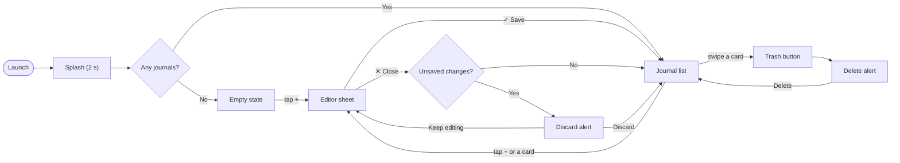
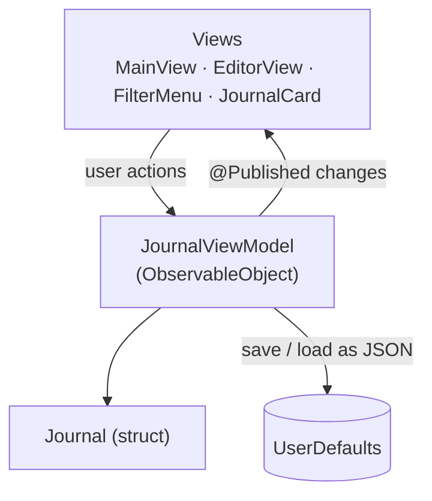

<p align="center">
  
</p>

<h1 align="center">Journali</h1>
<p align="center"><i>Your thoughts, your story.</i></p>

<p align="center">
  
  
  
  
  
</p>

---

> **Dear diary,**
> today I started a challenge to prove to myself that I can build a real app from a design file, not just follow a tutorial.
> No libraries. No shortcuts. Just Swift, SwiftUI, and a very dark purple theme.
> It worked. This is it.

## ✨ What it does

Journali is a small, fast, offline journaling app for iPhone.

- **Write** a new entry with a title and free text
- **Edit** any entry by tapping its card
- **Delete** with a swipe, followed by a confirmation alert
- **Bookmark** the entries that matter most
- **Search** across titles *and* text
- **Filter** to see all entries (newest first) or only bookmarked ones
- **Never lose words by accident**: closing the editor with unsaved changes asks first, and the sheet cannot be swiped away while you have unsaved text
- **Accessible**: every icon-only button has a VoiceOver label
- **Remembers everything**: entries are saved on the device and are still there after you close the app

## 📱 Screenshots

| Splash | Empty state | Journal list | Editor |
|:---:|:---:|:---:|:---:|
|  |  |  |  |

<sub>Screenshots taken on an iPhone 17.</sub>

## 🧭 How the app flows



## 🏗️ Architecture: MVVM, kept simple



- **Model:** `Journal` is a plain struct (`Identifiable`, `Codable`).
- **ViewModel:** `JournalViewModel` owns the list, the search text and the filter. It sorts, filters, searches, adds, edits, deletes, and saves everything on the device.
- **Views:** the screens only display data and report taps. They never decide *how* things are saved.
- One editor screen handles both **New** and **Edit**. The ViewModel checks the entry's `id`: found means update, not found means add.
- The state tools each have one clear job:
  - `@StateObject` creates the ViewModel once in `MainView`
  - `@ObservedObject` shares it with `EditorView`
  - `@Binding` lets `FilterMenu` change the filter
  - `@State` holds what each screen controls on its own

## 🎨 Built exactly to spec

The design file defined everything, so the code follows it:

| Token | Value | Used for |
|---|---|---|
| Primary | `#7F81FF` | Save button, active actions |
| Accent text | `#AF99FD` | Journal titles, empty-state heading |
| Text primary | `#FFFFFF` | Headings, journal content |
| Secondary text | `#A39A9A` | Entry dates |
| Surface | `#1C1C1E` | Cards, editor sheet |
| Background | `#000000` | Main screen |
| Destructive | `#FD453C` | Delete |

- **Typography:** SF Pro, using the design's full type scale (Display 42 down to Caption 14).
- **Icons:** SF Symbols only (`xmark`, `bookmark`, `bookmark.fill`, `trash.fill`, `checkmark`, `plus`, `line.3.horizontal.decrease`).
- **Components:** native iOS alerts, keyboard and navigation, following Apple's Human Interface Guidelines.

All colors and fonts live in one file, `Theme.swift`, so changing the look means editing one line.

## 🧰 What's inside (tech)

| Concept | Where it shows up |
|---|---|
| Layout | `VStack`, `HStack`, `ZStack`, `List` |
| Navigation | `NavigationStack`, `.sheet(item:)`, `.toolbar` |
| State | `@State`, `@Binding`, `@StateObject`, `@ObservedObject`, `@Published`, `@FocusState`, `@Environment` |
| MVVM | `Journal`, `JournalViewModel`, the views |
| Search and filter | `.searchable`, a `Menu` with an inline `Picker` |
| List interactions | `.swipeActions`, confirmation alerts |
| Forms | `TextField`, `TextEditor` (with a custom placeholder) |
| Persistence | `Codable` + JSON + `UserDefaults` |
| UX details | Empty state, auto-focused keyboard, drag-to-dismiss keyboard, VoiceOver labels |

**Zero third-party dependencies.** Only Apple frameworks: SwiftUI, Combine and Foundation.

## 📂 Project structure

```
Journali/
├── App/
│   └── JournaliApp.swift          # Entry point + splash timing
├── Models/
│   └── Journal.swift              # The Journal struct
├── ViewModels/
│   └── JournalViewModel.swift     # List, search, filter, add, edit, delete, save
├── Views/
│   ├── SplashView.swift
│   ├── MainView.swift             # List, search, toolbar, swipe to delete
│   ├── EditorView.swift           # New / Edit journal sheet
│   ├── FilterMenu.swift           # Sort by Bookmark / Entry Date
│   ├── JournalCard.swift
│   └── EmptyStateView.swift
├── Design/
│   └── Theme.swift                # Colors and fonts from the design file
├── Utilities/
│   └── Date+Format.swift          # dd/MM/yyyy dates
└── Assets.xcassets                # Illustrations

Journali.icon                      # App icon (made with Icon Composer)
```

## 🚀 Run it

**Requirements:** Xcode 26 or newer, iOS 17 or newer.

1. Clone the repo
   ```bash
   git clone https://github.com/nadawaja/Journali.git
   ```
2. Open `Journali.xcodeproj` in Xcode.
3. Pick a simulator and press **⌘R**.

**On a real iPhone (no internet needed afterwards):**

1. Connect the iPhone with a cable and tap **Trust**.
2. Turn on **Settings > Privacy & Security > Developer Mode** and restart the phone.
3. In Xcode: **Signing & Capabilities** > *Automatically manage signing* > choose your Apple ID team.
4. Select your iPhone as the destination and press **⌘R**.

With a free Apple ID the app expires after 7 days. Plug in and run again to renew it.

## 👤 Author

Built by **Nada Awaja** as a challenge to prove I can ship.
Find me on [GitHub](https://github.com/nadawaja).

<p align="center"><sub>Made with ☕ and a lot of ⌘R</sub></p>
